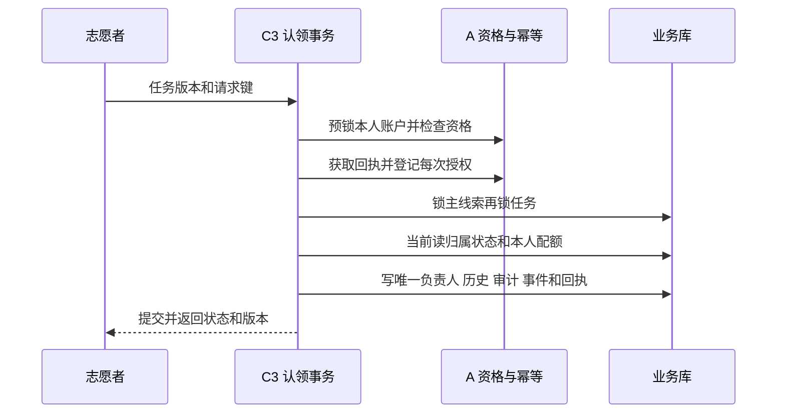
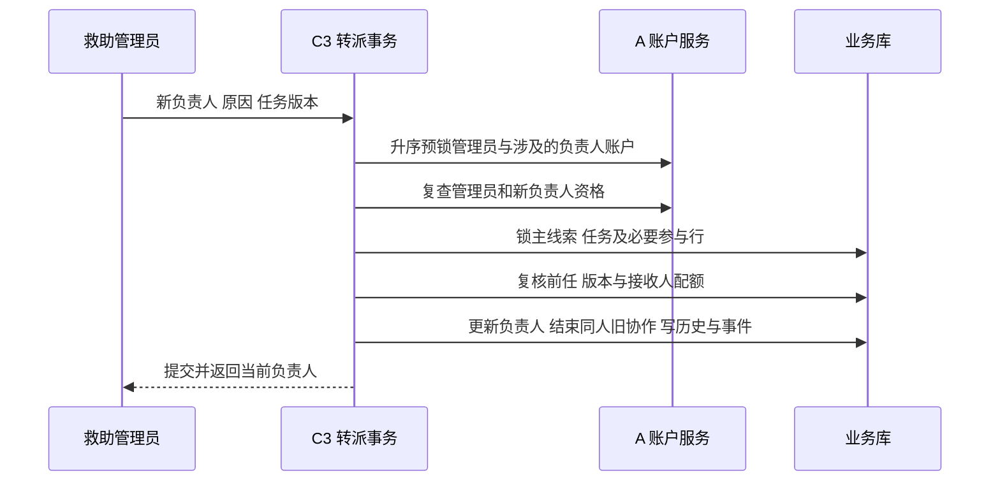
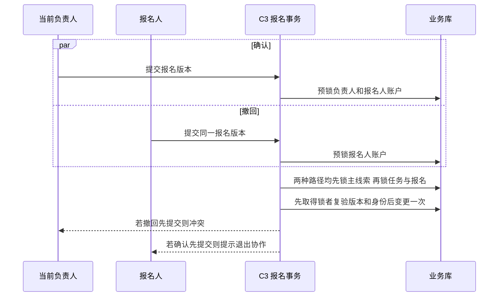
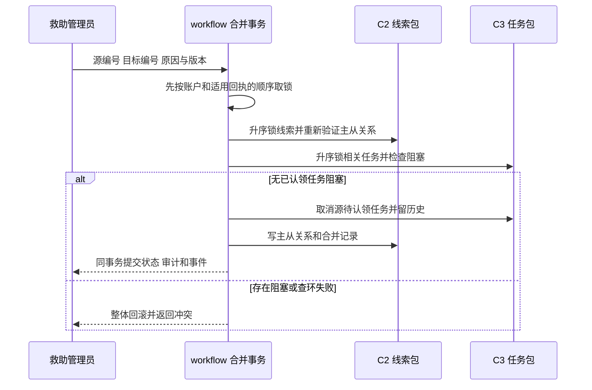
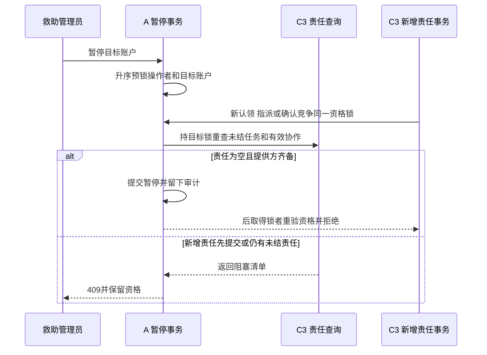

# B 模块详细设计说明书

**评审基线**　main `7d0d14f`、概要设计 V1.1 评阅修订版、阶段一差距盘点。范围为 C2、C3 和 BE.3.8，数据库目标为 MySQL Server 8.0.46 / InnoDB。以下是进入阶段二前的推荐设计。标记「待确认」的决策有可先采用的默认值，接口评审后按受影响的字段、状态、迁移和用例调整。业务代码、SQL 迁移和业务验收均处于设计阶段。

参考 [阶段一差距分析](B模块代码与最新基线差距分析表.md)、[九项确认清单](需与A-C-D-E确认的接口与迁移问题清单.md)、[V1.1 评阅版](https://github.com/MFJ-123/stray-animal-rescue-system/tree/7d0d14f/docs/design)、[main 跨模块契约](https://github.com/MFJ-123/stray-animal-rescue-system/blob/7d0d14f/docs/跨模块契约清单.md)。

## 1 草稿重构与工程接入

### Java 包和职责

| 草稿位置 | 推荐落点 | 保留或移动的行为 |
|---|---|---|
| `ClueService.submit` 与 `act` 的 supplements、review、follows、unfollow | `domain/clue/ClueService` 的分名方法 | 受理、追加补充、核实和关注由 C2 处理。新增/更新均通过 C2 仓储。C2 负责校验允许公开的字段。 |
| `ClueService.act` 的 withdraw、merge、close | `domain/workflow/RescueWorkflowService` | 分别拆为撤回、合并、结案命令。C2 保留锁定线索、写撤回或终止申请、建立合并关系和写结局等单步动作。C3 提供查询阻塞和取消待认领任务。 |
| `ClueService.act` 的 reopen | C2 的重新组织操作，复用 workflow 的结清检查 | workflow 先查询对应已取消任务和全部未结任务，C2 写入恢复核实的原因。该分支复用结案所需的跨包锁规则。 |
| `TaskService.create`、`act:start`、`act:progress` 中首次执行分支 | 同一个 `RescueWorkflowService` | 负责建任务、开始执行两个跨包命令。负责人在 CLAIMED 时首次发进度也进入开始事务，再追加进度。C3 保留任务插入、状态更新和进度写入的原子方法。 |
| `TaskService.act` 的 claim、participants、执行中 progress、confirm-progress、owner-exit、transfer、result、acceptance、cancel、priority，及 `participation` | `domain/rescue/TaskService` 或同包报名服务 | 认领、报名、确认、撤回、退出、转派、结果与验收、取消、优先级等各用显式方法。角色及状态检查与更新同事务。 `checkQuota`、`addParticipant`、状态更新留在 C3。 `promote` 改为更新 owner_id、结束接受人已有活动协作关系并追加负责人历史。 |
| `TaskService.cancelUnclaimed`、`clueId` | C3 的内部原子操作和查询 | 取消加入调用方事务，使用可信 actor、取消事实和已锁任务。审批由 workflow 完成后调用原子动作。任务归属查询由 C3 提供。 |
| `TaskClues.lockVerifiedMaster`、`lock`、`markProcessing` | `domain/clue` 的 `ClueWorkflowOperations`（建议名） | 校验或更新锁定线索，仅查 C2 数据。由 workflow 经 C3 校验 task.clue_id 与活动任务归属后调用 markProcessing。 `followers` 移入 C2 授权查询供事件解析。 |
| `RescueQueries`、`RescueStore` | C2/C3 独立查询及各自 persistence | C2 负责公开/本人/审核/重复候选。C3 负责任务、报名、历史、未结清单和 TASK 责任查询。共享 JDBC 包装拆回按表归属的仓储。workflow 通过领域接口取锁、查、写。 |
| `UnclaimedRescueReminder.scan`、`TaskService.remindUnclaimed` | job 入口＋C3 单任务提醒事务 | job 每分钟查询候选，逐任务在新事务调用 C3；失败可重扫。C3 负责时间边界、审计和提醒事件，E 消费。 |
| `RescueController`、`Command`、`RescueProblem` | `web/clue`、`web/rescue` 的类型化 DTO 和 A 公共异常 | 以显式方法转调 C2、C3 或 workflow。前缀 /api/v1。参数校验后才打开业务事务。角色和状态在事务内复核。 |

**五个正式跨包入口**为 createTask、startTask、mergeClues、withdrawClue、closeClue。开始和撤回含各自的复用分支。跨包原子服务用 MANDATORY，公共幂等用 REQUIRED 加入同一外层事务。C2、C3 的原子服务各只访问本包数据。普通 C3 命令如需取得与跨包命令相同的主线索互斥锁，由 C2 暴露独立的锁定端口，调用方向保持单向。C2 状态变更通过 workflow 协作，C2 不注入 C3 的命令服务。

### 草稿适配桩的删除映射

| 原方法或用法 | A 或 C 的落点 |
|---|---|
| `currentActor()`、`requestId()` | `AccessInterceptor.current(request).id()`、`RequestIdFilter.get(request)`。通过 `CurrentAccess.load/requireRole` 从服务端加载管理角色与有效志愿能力。后台使用受控请求号和系统经办标识。 |
| 布尔角色／本地对象判断 | V1.1 的 authorize 对应 `ObjectAuthorization.require(actor,type,id,action)`、`project`、`projectPublic`；B 注册 CLUE/TASK/PARTICIPANT `ObjectPolicy`。策略通过本地仓储判断当前归属。写入的授权检查置于预定业务锁内，并在回放执行。 |
| `lockActiveVolunteer(userId)` | A 的 `AccessService.requireAccount(id,true)` 用于事务预锁所有必需账户，`lockActiveVolunteer(long)` 复核资格并返回 Account。只从 A 获取所需 ID、状态，敏感字段不进入响应或审计。 |
| `RescueController.ok/problem`、`checkVersion` | `ApiResponse.success(data,request)`、`BusinessException`、`GlobalExceptionHandler`、`Versions.require(long,long)`。保留统一 data 和 requestId，版本冲突使用 data.currentVersion。需要返回 currentState 时在同一业务层基于授权构建冲突 data。 |
| `once(...,work)` | `IdempotencyService.execute(actor,action,key,payload,resultClass,authorizeEveryTime,work)`。后端常量动作如 B.TASK.CLAIM.V1，payload 包含目标 ID、字段和适用的 expectedVersion，排除 requestKey。集合编号排序，首次成功存最小 DTO。回放只复查权限并返回原快照。 |
| `record(...,recipients)`、`remindAdministrators(...)` | V1.1 的 appendAudit/appendOutbox 对应 `AuditWriter.append(Change)` 与 `OutboxService.append(key,type,objectType,objectId,references)`。B 使用 RESCUE 模块和大写动作码，同事务写业务事实、审计及必要事件。 |
| `rescueAdministrators()` | 取消 B 的直接投递及测试名单。E 的 `OutboxHandler.handle(Event)` 查 A 的实际角色，再经 B 的事实和可见范围选接收人。转派或取消场景由 B 提供当次历史快照。 |
| `validateClassification(species,region)` | 依据 C 暴露的真实 `animal_type` 查询验证 typeId 与启用状态。地区使用 V1.1 的公开区域字符串并限制长度。未知物种由字典中的有效未知项表达。 |
| `bindPhotos`、`photoIds`、`requireLinkableAnimal` | 把所需接口分为 C 的附件绑定/受控读取和动物校验。调用方提供可信 actor、对象及编号列表。C 服务未接入时相应入口按 503 反馈，测试从接口注入局部夹具。 |
| `openResponsibilities` | C3 实现 A 的 `ResponsibilityProvider` Bean，module 为 TASK，真实查询后返回 `List<Responsibility>`。 |

删除 `RescuePartners` 接口和 `Fixtures` 的整合替身。验收测试用主工程 Spring 上下文、真实 A 服务和 Flyway。独立测试仅可替代 C 尚未接入的接口或可控时钟，覆盖真实接线时再移除相应替代件。生产缺依赖时相应动作显式失败，避免虚假成功。

### Vue 接入

移除 `rescueHostKey` 和依赖注入，在 `frontend/src/api/clue.ts`、`rescue.ts` 组合 A 的 `request<T>(path,options)`。路径传 `/public/clues`、`/tasks/118/claim` 等相对地址，客户端统一加前缀并提供会话、CSRF、错误处理。从 `ApiEnvelope<T>.data` 取数据，使用 camelCase DTO。用户状态复用 `currentUser`、`refreshMe` 和角色判断。附件由 C 服务上传后获得编号，写命令提交编号。复用 A 的 `versionedCommand` 处理同时带版本和请求键的动作。0014 报名仅保存一枚请求键并复用原正文，确认仅发送报名版本。冲突时刷新对象，明确向用户显示当前状态和下一步。

默认页面为 `#/clue` 公开浏览、`#/clue/report` 上报、`#/clue/mine` 本人上报、`#/clue/review` 管理员队列、`#/rescue` 任务列表、`#/rescue/:taskId` 任务详情和 `#/rescue/manage` 救助管理。B 定义模块路由，A 汇总挂载。按钮根据可用动作显示，读取和写入权限由后端决定。确切路由命名和菜单登记为 B-01 待确认边界。

## 2 需求与验收核对矩阵

### 通用接口规则

ID 是正整数十进制字符串，版本是非负整数并以 BIGINT 存储。接口时刻为带时区的 ISO-8601，服务端 UTC 持久化，用 Asia/Shanghai 展示。更新以路径中的对象和 expectedVersion 标识读到的状态，公共响应为 code、message、requestId、data。请求键沿用 A 的 8～64 字符格式，仅在专项契约或已明确的幂等命令中必填。带键命令的同键异参为 409。无键版本命令成功后，旧版本重放按 409 处理，重复取消的已授权同键重放见 4.2。

每行异常按 **400、401、403、409** 顺序列出，分别对应输入、会话、对象身份和当前业务状态。对象确实不存在或匿名不可见返回 404。所需依赖故障返回 503，事务整体回滚。结果返回中的 state 和 version 指本次更新后的主对象，复用回执时为首次成功快照。

| SAR-SYS | 操作者、页面与 HTTP | 输入和校验 | 成功 data | 400 / 401 / 403 / 409 与验收 |
|---|---|---|---|---|
| 0007 | 已登录普通账户或有效志愿者，`#/clue/report`，POST /clues | typeId 有效含未知项，region 1～32 字，detailLocation 1～500 字，foundAt≤服务端当前时刻＋5 分钟，description 20～500 字，1～6 个有效且本人可绑定的 attachmentIds，requestKey。 | clueId、PENDING_REVIEW、version；同键同参重放原编号。 | 缺项/超限/时间错误；未登录；附件越权；同键异参或附件已被其他对象绑定。TC-02。 |
| 0008 | 上报者本人，`#/clue/mine`，POST /clues/{id}/supplements 或 /withdraw | 补充 detail、expectedVersion、可选 attachmentIds。待审核/待补充时追加供重审，核实后追加原记录。撤回 reason、expectedVersion。 | clueId、state、version、handling（WITHDRAWN 或 TERMINATION_REQUESTED），后者附终止申请记录编号。 | 文本/附件无效；未登录；非本人；旧版本或终态。已认领转终止申请。TC-02、03。 |
| 0009 | RESCUE_ADMIN，`#/clue/review`，POST /clues/{id}/review | decision 为 VERIFIED/NEEDS_INFO/REJECTED，后两者 reason 10～500 字。发布时 publicFields 只可包含允许字段，expectedVersion。 | clueId、state、version、reviewId。 | 非法决定、理由/公开字段错误；未登录；无救助管理权；非待审核或旧版本。TC-02。 |
| 0010 | RESCUE_ADMIN，审核详情，GET /clues/{id}/candidates、POST /clues/{id}/merge | 候选同区域且发现时刻差≤24 小时。合并传 targetId、reason、源 expectedVersion，在锁内复查目标、环和双方任务。 | 候选列表；合并返回 clueId、masterId、MERGED、version。 | ID/理由错误；未登录；无管理权；自合并、环、旧版本或有认领阻塞，允许时返回 blockedTaskIds。TC-03。 |
| 0011 | 已登录账户，公开详情，POST /clues/{id}/follows 或 DELETE /clues/{id}/follows/current | 新增传 requestKey，取消无需指定 userId。目标公开方可关注，允许删除本人已有关注。 | clueId、following、适用的公开进展摘要。 | 无效 ID/键；未登录；目标无公开访问权或试图操作他人关注；同键异参。TC-03。 |
| 0012 | RESCUE_ADMIN，审核详情，POST /clues/{id}/close | outcome 枚举、reason、线索 expectedVersion，主线索须 VERIFIED 或 PROCESSING 且无未结任务。 | clueId、CLOSED、outcome、version。 | 结局/说明错误；未登录；无管理权；旧版本或阻塞，授权后返回 blockedTaskIds。TC-03。 |
| 0013 | RESCUE_ADMIN，核实线索详情建任务，POST /tasks | clueId、area、detail、collaboratorLimit 0～5、可选 ownerId、requestKey。校验主线索、可选受派人资格和最多 3 项配额。 | taskId、OPEN 或 CLAIMED、ownerId（可空）、version。 | 参数超限；未登录；无管理权/受派人资格无效；已有未结任务、超配额、同键异参。TC-04、16。 |
| 0014 | 有效志愿者从 `#/rescue` 认领或报名，当前有效负责人在任务详情确认 | **POST /tasks/{id}/claim** 传任务 expectedVersion＋requestKey。**POST /tasks/{id}/participants** 仅必填 requestKey。**POST /participants/{id}/confirm** 仅必填报名 expectedVersion。确认查报名待确认、申请人资格、任务可协作与剩余名额。 | 认领 taskId、ownerId、state、version。报名/确认 participantId、state、version。 | 必填键/相应版本错；未登录；无资格或非当前负责人；状态/版本/重复报名/配额冲突。TC-04、17。 |
| 0015 | 当前有效负责人开始，负责人或有效已确认协作者记录，任务详情 POST /tasks/{id}/start、/progress、/confirm-progress | start 传任务 expectedVersion；progress 传 detail、expectedVersion、可选 attachmentIds/replacesId；确认传 progressId 和 expectedVersion。更正追加记录，引用本任务本人旧记录。 | taskId、taskState、clueState、相关版本；记录时返回 progressId 和确认状态。 | 摘要或证据字段错误；未登录；协作者越权开始/确认、前任负责人无权；旧版本、状态或异对象引用。TC-05。 |
| 0016 | 本人撤回/退出、负责人申请退出、管理员转派，任务详情或管理页 | 报名撤回传报名 expectedVersion，退出另传 reason。负责人申请退出传任务版本及原因，转派传 newOwnerId（退回待认领时为 null 的默认设计）、reason、任务版本，接收人须有效且未满额。 | participantId 或 taskId、state、version；转派附 ownerId，退出申请附记录编号。 | 理由/ID 错误；未登录；非本人/当前负责人/管理员；版本、报名已确认或配额冲突。TC-05、17。 |
| 0017 | 当前有效负责人提交，RESCUE_ADMIN 验收，POST /tasks/{id}/result、/acceptance | 结果传 kind、detail 20～500 字、任务 expectedVersion、**非空 animalIds 数组或无档案时必填 missingReason**。IDs 去重并逐项验证。验收传 decision、expectedVersion，退回必填 reason。 | taskId、state、version，结果返回 resultId，验收返回意见和对应结果引用。 | 内容/数组/退回理由不合法；未登录；非当前负责人、无验收权或无动物关联权限；旧版本、状态、动物状态改变。TC-05。 |
| 0018 | 后台定时提醒；RESCUE_ADMIN 从管理页取消、调优先级、重新组织 | 取消传 reason、expectedVersion。计划将 requestKey 纳入取消回执，是否作为正式必填待 A 确认，见 4.2。提醒只取 Clock，当前 OPEN 满 24 小时。重新组织须关联已取消任务。 | 取消返回 taskId、CANCELLED、version；提醒登记稳定事件；优先级/重新组织返回状态、版本。 | 理由/枚举错误；HTTP 未登录；普通志愿者越权取消；已终结、旧版本或不满足重组条件。TC-05、16。 |

上表中浏览器 HTTP 路径统一加 /api/v1。V1.1 特定条目与旧草稿有差别，0008 沿用一个撤回入口分流终止申请，0014 三个请求最小体以专项条目为准，0017 沿用数组和新版字段。草稿外的页面 URL、补充照片上限、说明长度及枚举属于建议细化项。默认补充正文 1～500 字、附 0～6 张照片；非专门规定的经办理由 1～500 字，核实、负责人结果的专项长度按上表。报错包含授权范围内可恢复的信息。

## 3 动作权限和字段可见性

角色来自 A 的账户，行权限来自本人、当前负责人和当前有效协作关系。表中成员列表示单独拥有该关系时的权限，兼任时仍分别核验动作的角色和关系约束。另有「有效志愿者」一列用于尚无任务对象关系的认领与报名。

| 动作 | 匿名 | 上报者 | 关注者 | 有效志愿者 | 待确认报名人 | 已确认协作者 | 当前负责人 | 救助管理员 |
|---|---|---|---|---|---|---|---|---|
| 公开线索、里程碑 | 可 | 可 | 可 | 可 | 可 | 可 | 可 | 可 |
| 上报新线索、关注或取消本人关注 | — | 可 | 可 | 可 | 可 | 可 | 可 | 以个人身份可 |
| 本人上报详情、补充、撤回或申请终止 | — | 本人可 | — | — | — | — | — | 自己上报时按本人规则 |
| 审核线索、合并、结案、恢复核实 | — | — | — | — | — | — | — | 职责范围内可 |
| 浏览可认领任务及安全摘要 | — | — | — | 可 | 有效时可 | 有效时可 | 有效时可 | 可 |
| 读取执行所需的精确位置、任务资料 | — | 可读本人线索 | — | — | — | 有效时可 | 有效时可 | 可 |
| 认领、报名 | — | — | — | 可 | 按状态及有效资格 | 按状态及有效资格 | 可对其他任务操作且不超额 | 兼有效志愿者按志愿者办理 |
| 查询/撤回本人待确认报名 | — | — | — | — | 本人可 | — | 可读本任务报名清单 | 可读职责范围 |
| 追加进度、本人记录更正、退出协作 | — | — | — | — | — | 有效时可按状态追加、更正及退出；主动结束关系可查本人状态 | 有效时可记录并更正 | 授权读与监管 |
| 确认报名或协作观察、开始、提交结果、申请退出负责人 | — | — | — | — | — | — | 当前有效且状态允许 | 兼任当前负责人时按本人办理 |
| 建任务/指派、转派、取消、验收及优先级 | — | — | — | — | — | — | — | 可 |

默认管理员在管理入口办理其职责动作。系统管理员与领养管理员单凭这些角色无救助管理权限。转派后的历史负责人只看到仍有权限的公开或本人关系数据，旧链接不会还原原执行权限。待确认报名只显示本人报名及任务安全摘要，分享精确位置严格限上报者、相关任务有效参与者和救助管理员。收件人和审计查询另按 A/E 各自职责过滤。

**GET /api/v1/public/clues** 先按 allowed-to-publish 及状态 VERIFIED/PROCESSING/CLOSED 过滤，再做分页及 count。支持 region、typeId（作为物种筛选）、state、keyword、page（默认 1）、pageSize（默认 20，最大 50），默认发布时间降序，允许更新时间降序，稳定次键 id。关键词查询已公开摘要。默认 `data.items[]` 仅含 `clueId`、`typeId`、`typeName`、`region`、`state`、`publicSummary`、`publishedAt`、`updatedAt`，另有分页字段。精确地点、发现时刻、上报者身份及联络方式、内部原文、审核理由、附件原件编号和控制版本均不出现在公开列表。公开详情可独立返回已确认、已批准的里程碑摘要及脱敏副本引用。字段投影由 C2 查询和 CLUE 策略共同执行，嵌套内容分别授权后组装。

## 4 三套状态机

### 4.1 救助线索 clue

| 前态 | 动作 | 检查条件 | 后态 | 关联变化 | 失败结果 |
|---|---|---|---|---|---|
| 无 | 上报 | 会话、字典、时间、照片归属、请求键 | PENDING_REVIEW | C2 建线索与上报记录、绑定附件、审计和事件 | 400 / 401 / 403 / 409 |
| PENDING_REVIEW / NEEDS_INFO | 补充重提 | 本人、版本、材料 | PENDING_REVIEW | 追加补充事实和附件，保留原编号及旧历史 | 403 / 409 |
| VERIFIED / PROCESSING | 追加补充 | 本人、版本，无需重审原文 | 原态 | 新增补充记录并递增版本。默认允许处理中继续补充，待确认 | 403 / 409 |
| PENDING_REVIEW | 核实、待补充、驳回 | 管理员、版本、理由与公开字段 | VERIFIED / NEEDS_INFO / REJECTED | 写 clue_review、审计和通知，只有已批准字段可公开 | 400 / 403 / 409 |
| PENDING_REVIEW / NEEDS_INFO / VERIFIED / PROCESSING | 撤回或终止请求 | 本人、版本，无未结任务或唯一未结为 OPEN 时可撤回；已有认领或执行则登记终止请求 | WITHDRAWN 或原态 | 无未结直接撤回；OPEN 由 C3 原子取消再撤回；已有认领保留任务及线索，新增一条终止申请。终止申请以线索和活动任务去重 | 403 / 409 |
| PENDING_REVIEW / NEEDS_INFO / VERIFIED / PROCESSING | 合并 | 管理员、源版本、目标主线索有效，源≠目标，当前主从图无环，双方无已认领阻塞 | MERGED | 源指向目标，原上报及附件保留。源仍待认领的任务按取消规则清理。目标待认领任务保留 | 400 / 403 / 409＋授权阻塞 |
| VERIFIED | markProcessing | 已锁主线索，C3 已校验当前任务确实属于主线索，使用协调器读取的当前线索版本 | PROCESSING | 同事务中任务开始并递增任务版本。重复转派接续时若线索已 PROCESSING，只做有效状态检查 | 409 整体回滚 |
| VERIFIED / PROCESSING | 结案 | 管理员、主线索、版本、所有关联任务已完成或取消 | CLOSED | 记录结局、经办人、结案时刻及脱敏摘要。任务验收只改变任务，不代替结案 | 400 / 403 / 409＋授权阻塞 |
| PROCESSING | 重新组织 | 管理员、版本、关联任务已取消且无其他未结 | VERIFIED | 保存原因和关联任务，允许后续创建新任务 | 403 / 409 |
| CLOSED / MERGED / WITHDRAWN / REJECTED | 读取历史 | 按公开、本人和职责范围 | 原态 | MERGED 保留旧编号并按授权展示主编号 | 403 / 404 |

**合并查环默认方案**　主线索目标要求 `master_id IS NULL`。发现阶段找出源、目标和源已有从属线索；锁定源和目标及需要检查的父链记录，复查目标仍为根、源仍可合并及父链访问集合无重复。默认有从线索的源返回阻塞，保留阶段一草稿的单层关系约束，管理员先协调已有从线索关系。还需用 `master_id` 索引在源锁内重新检查是否已新增从线索。并发合并遵守同一主线索锁规则。反向或多跳形成环时返回 409。团队若允许整棵子树重新归属，则由同一协调器锁全路径和受影响子树，再追加专门变更及历史测试。候选 24 小时窗口只用于提示。

### 4.2 救助任务 rescue_task

| 前态 | 动作 | 检查条件 | 后态 | 关联变化 | 失败结果 |
|---|---|---|---|---|---|
| 无 | 建任务，可直接指派 | 管理员；主线索 VERIFIED，无未结任务；受派人有效且未结负责人任务少于 3 | OPEN 或 CLAIMED | OPEN 时 ownerId 为空，记 open_since。直接指派写 owner、变更历史、审计及事件 | 403 / 409 |
| OPEN | 认领 | 志愿资格、任务版本、无负责人、配额＜3 | CLAIMED | 同一事务写唯一负责人、责任历史、回执、审计和事件 | 403 / 409 |
| CLAIMED | 开始或负责人首次追加进度 | 当前负责人、资格、任务版本、主线索属实 | IN_PROGRESS | workflow 调 markProcessing，必要时 C2 置 PROCESSING。首次进度与两个状态一起提交 | 403 / 409 / 503 |
| IN_PROGRESS | 追加进度或确认观察 | 当前负责人，或有效已确认协作者仅追加；版本合法 | 原态 | 记录追加或确认时间和经办人，更新任务版本。协作者待确认的内容始终保留在授权历史中 | 403 / 409 |
| CLAIMED / IN_PROGRESS | 申请退出负责人 | 当前负责人、版本、理由 | 原态 | 追加待管理处置的退出事实，负责人仍承担责任 | 403 / 409 |
| OPEN / CLAIMED / IN_PROGRESS | 指派或转派 | 管理员、版本、新负责人资格和配额。退回操作只允许原来有负责人的任务 | CLAIMED 或 OPEN | 新受派人接任后重新开始，旧负责人即时失去写权限。转为 OPEN 重置 open_since。历史、主线索状态均保留。待验收任务先验收退回或按授权取消，再处置责任 | 403 / 409 |
| IN_PROGRESS | 提交结果 | 当前负责人、有效资格、版本、结果与动物校验 | PENDING_ACCEPTANCE | 追加本轮 RESULT_SUBMITTED，冻结动物编号集合与事实说明，关联真实动物。缺档案时保存原因 | 400 / 403 / 409 / 503 |
| PENDING_ACCEPTANCE | 通过或退回 | 管理员、版本、当前冻结结果；通过时复核本轮关联资格和动物状态 | COMPLETED 或 IN_PROGRESS | 追加验收决定、经办人与本轮 resultId。通过保存结果类别和完成时刻，活动参与结束。退回保留原结果及理由，后续重提新建结果轮次 | 403 / 409 / 503 |
| OPEN / CLAIMED / IN_PROGRESS / PENDING_ACCEPTANCE | 取消 | 管理员、版本、理由；或 workflow 已校验允许联动取消，且任务确实仍处于 OPEN | CANCELLED | 先读取相关接收人及取消前状态，随后关闭 PENDING 和结束 ACTIVE，写任务、原因、时刻和历史，发布一个取消事实。原负责人保留在历史中，当前权限立即终止 | 400 / 403 / 409 |
| OPEN | 定时提醒 | Clock≥open_since＋24 小时且本任务未登记提醒 | OPEN | 同事务登记提醒标记、审计和 outbox。后台标记不递增前台业务版本 | 未到期/已提醒则跳过，故障可重扫 |
| 各未终结状态 | 调整优先级 | 管理员、版本及合法优先级 | 原态 | 记录历史，公共里程碑按披露审核 | 403 / 409 |
| COMPLETED / CANCELLED | 状态更新 | 终态限制；先识别可信取消回放 | 原态 | 同一取消事实只写一次 | 新命令 409；同键同参已授权取消回放见下文 |

`open_clue_id` 仅在四种未终结状态取 clue_id，终态取 NULL，唯一索引作为数据库最后防线。应用在锁住主线索后先查现有未结任务，重读真实状态和归属。将命中指定唯一索引的业务竞争映射为 409，其余数据库异常交全局错误处理。通过/取消释放唯一槽位并保留旧记录。

默认补齐取消的重试语义。使用原键及原正文、操作者仍有权限时返回成功回执，新键再次取消一个终态任务返回 409。专项接口原来只要求 reason、expectedVersion，兼容时允许省略 requestKey，以版本和取消事实唯一性控制重复，无键旧版本返回 409。B 自有页面发送 requestKey。A/B/E 确认是否正式把它定为必填，并同步需求关于重复撤销返回值的描述。管理员调优先级的失败不影响提醒事实。

认领的回放授权仍检查当前有效资格及任务可见性。首次竞争落败由业务检查返回 409。若同一操作者先前按该任务版本认领成功，随后已经失去负责人关系，则根据认领历史中的操作者与认领前版本拒绝旧回放，避免把前任的成功快照显示为当前关系。重新进入 OPEN 后，可持新版本和新键发起新的认领。

### 4.3 协作报名 participant

负责人当前关系使用 rescue_task.owner_id，历史保留在 task_progress 的指派、认领、转派记录中。participant 专门表示协作报名。

| 前态 | 动作 | 检查条件 | 后态 | 关联变化 | 失败结果 |
|---|---|---|---|---|---|
| 无或仅历史终态 | 报名 | 有效志愿者、本人非当前负责人，任务 CLAIMED/IN_PROGRESS，limit＞0，无现存活动报名 | PENDING | 创建新行和审计，不占已确认协作名额。重报新编号 | 403 / 409 |
| PENDING | 确认 | 当前有效负责人、报名者有效、报名版本、任务可协作、余量 | ACTIVE | 占用一个协作名额，记录经办人。仅递增报名版本 | 403 / 409 |
| PENDING | 拒绝 | 当前负责人、报名版本、理由 | CLOSED | 保存处理理由和时刻 | 403 / 409 |
| PENDING | 撤回 | 本人、报名版本 | WITHDRAWN | 保留旧记录，可发起新报名 | 403 / 409 |
| ACTIVE | 退出 | 本人、报名版本、理由 | EXITED | 释放名额及执行权限，追加历史 | 403 / 409 |
| PENDING / ACTIVE | 随任务取消、完成或本人改任负责人 | 对应任务命令已取得授权并按序锁定报名 | CLOSED / ENDED | 清理需处理的报名。任务终止清理全部。改任负责人只结束其本人原协作行，保留其余关系 | 409 / 503 整体回滚 |
| 其他终态 | 重新报名 | 走新建检查 | 旧记录原态，新记录 PENDING | 旧资料和决策保持可审计 | 403 / 409 |

`active_user_id` 在 PENDING/ACTIVE 时取 user_id，唯一索引 `(task_id,active_user_id)`。确认时锁住任务再查 ACTIVE 数，保持上限 0～5。报名和确认只更新报名版本，不使无关的任务表单版本失效。转派、取消和任务状态变化仍递增任务版本。志愿资格暂停时，待确认报名不计为已承担执行责任，申请人暂停后若负责人尝试确认，将在 A 的资格锁复查时被拒绝。默认保留申请供本人撤回或管理员终止任务时清理。

## 5 锁序、事务图和事件规则

### 5.1 全局锁序

推荐用统一的分组顺序消除已识别的应用级锁反转。实际 MySQL 仍可能因索引、外键隐式锁或运维 DDL 发生死锁，须验证并保留回滚恢复测试。这里将 V1.1 的「先锁主线索」限定为**线索/任务业务对象阶段**的第一把锁。账户、角色和回执先按 A 的公共事务约定处理。组内评审时把此解释写入设计变更记录。

| 次序 | 锁和边界 |
|---|---|
| 0 | 在事务外或进入写事务锁定前按索引查只用于发现的 ID，收集 actor、受派人、被确认志愿者等账户，涉及的动物、线索、任务、报名和附件。查询所得版本、角色和状态一律待锁后复查。确实需要访问管理护栏的 A 命令先锁 access_admin_guard，再锁账户。B 日常命令不访问护栏。 |
| 1 | 各账户以主键由小到大逐行预锁。B 的外层事务使用 A 的 requireAccount(id,true)，包含会被写入的新账户 FK。A 的角色读取在账户锁下执行，读取或修改多个角色行按账户和角色顺序。资格检查由 lockActiveVolunteer 完成，复用已经持有的账户锁。 |
| 2 | 需要请求回执时执行 A 的 IdempotencyService，加入外层事务。内部再次读取 actor 复用已持有的锁，再锁该命令回执。authorizeEveryTime 与 work 共用后续业务锁和当前读，回执返回前仍须授权。无键命令直接执行同一准入逻辑。跨包原子调用沿用外层命令上下文。 |
| 3 | 仅存在 C 动物状态/FK 联动时，通过 C 以动物 ID 升序锁定关联动物，先于线索和任务锁。死亡归档可在持动物锁下检查 B 的阻塞清单，返回后由有权入口另外处置，并重新发起归档。默认归档不在持动物锁后反向等待新的账户锁。字典分类在需要建立或更换 type_id 关系时按编号在动物/线索前校验。 |
| 4 | 对所有实需操作的主线索及目标线索按编号升序逐行加锁。随后按任务编号，再按报名、历史记录编号逐行锁定。需要共同检查的关注关系按固定复合键排序，附件绑定锁在其归属对象验证后取得，多个附件按编号升序。关注写入也锁所属线索。 |
| 5 | 在该事务写业务数据、历史、接收人事实、必要的附件绑定、审计和 outbox，再提交。写入 outbox 之前完成全部业务锁定与复查，E 的消费事务查询 B 事实时用只读受权接口。 |

各可变集合锁定后重新计算。发现新增了较早阶段的账户或动物，或出现应先锁的更小编号线索，结束本次事务并重新发现集合。验收预读到的结果轮次和动物集在任务锁内复查；轮次变化按版本冲突或整条命令重新发现处理。只允许在外层事务已经回滚后重新执行整条命令，沿用原键，无键命令沿用原预期版本。默认接 A 现有 503 错误映射，由客户端保留原命令供用户重试。自动重试上限及异常白名单待 A 统一决定。

**A 接入边界**　目前 `suspend` 先校验操作者角色并锁其账户，再锁目标账户。在操作者编号较大时，与 B 的账户升序可能形成反转。推荐 A 后续把 `suspend` 及涉及多账户的角色配置、资格审批统一改为先收集并按编号预锁账户，再进入权限检查、申请行和写入。保留角色配置需要的护栏先行规则。B 设计按统一顺序继续，联合并发验收前由 A 把上述入口纳入同一约定。仅调整 B 无法证明 A 现有的双账户路径遵循总序。

`findOpen` 在暂停事务内做账户锁保护下的当前或等效最新读。建议 A 将暂停事务使用 READ COMMITTED 并把 B 责任查询放在预锁之后；如保留其他隔离级别，需要约定不会先建立旧快照。责任清单读取 B 原子关系，不锁需要反向等待账户的对象。统计与 E 消费读取采用其独立只读上下文。

### 5.2 五条事务路径

**认领**



**转派**



**报名确认与撤回竞争**



**合并线索**



**资格暂停联动**



资格查询提供方缺失或失败时由 A 报 503。C3 返回的 type 默认 TASK_OWNER 或 TASK_COLLABORATOR，objectId 使用任务编号，path 使用 `#/rescue/{id}` 对应的应用内已登记链接，description 为安全状态摘要。待确认报名默认保留且不阻塞，不能在已暂停状态下获确认。

### 5.3 稳定事件键和消费者

| 事件 | 键和持久化规则 | 接收人和重复处理 |
|---|---|---|
| 24 小时未认领 | `B:TASK:{taskId}:UNCLAIMED`。默认每任务生命周期一次。退回 OPEN 更新 open_since，保留已有 reminded_at。扫描发现候选后，按线索→任务顺序逐条取锁重算阈值，在同事务写 reminded_at、审计和 outbox。 | E 查询当前救助管理员。并发扫描或进程重启至多登记同一个事件，业务事务失败不保留提醒标记。后台审计允许 actorId=0，事件仅包含 taskId、auditId 等合法正数引用。 |
| 取消任务 | `B:TASK:{taskId}:CANCELLED`。手动取消或线索撤回/合并触发的取消统一使用这一个事实键。先记录取消前 owner 与 PENDING/ACTIVE 参与者，再更新清理。 | 把当次接收人编号快照保存在 B 的取消记录私有字段中，E 按 progressId 或 auditId 取得。由 E 做账户及披露复查，旧消息跳转时重新授权。重放返回原回执，跳过再次登记。 |
| 其他状态和已发布进展 | `B:{objectType}:{objectId}:{fact}:V{version}`，多个事实使用不同动作码，历史事件也可用不可变记录编号。 | 事件以对象、历史或审计 ID 以及状态码为引用。E 依据职责、关系及公开审批生成消息正文。关注通知仅发送给查询时仍关注且已在事件发生前关注的人。 |

共用 `OutboxService.append` 的事件键上限 96 字符，全站唯一。E 默认使用 `UNIQUE(event_id,recipient_id)`，通过 A 的唯一 event_key 保证同事实。E 在 `handle` 内把消息写入和 DONE 确认纳入 A 的消费事务。消费者锁住 outbox 时 B 仅提供普通读取，不调用 B 写命令。取消关注后的新关注通知以消费端查到的有效关注关系为准，重新关注不回补旧事件。取消操作与已在投递中的事务如何线性化，以 B-08 与 E 的决议为准。阅读消息不授予对象访问权。

## 6 物理表和迁移排期

### 6.1 字段级映射

ID 与版本统一 MySQL 有符号 BIGINT，以和 A 的 `account.id` 对齐。DATETIME(6) 统一 UTC。以下保留 V1.1 表名及关系。支持筛选、审核、执行和责任历史所需的扩展字段在 D 登记时标注。

| 原表.字段 | 目标字段 | 转换和约束 |
|---|---|---|
| clue.id、reporter_id、master_id | clue 同名列 | 主键稳定；上报者 FK 指向 account，合并 FK 自引用，master_id 建索引。 |
| clue.species | clue.type_id | 按 `animal_type.code` 查字典 ID，未经确认的旧值列出异常映射。未知项使用正式字典，保留源物种原值作为迁移证据。 |
| clue.region、detail_location、found_at、description | clue 同名 | region 收敛至 varchar(32)，详情 500 字、UTC 时间和原描述保留。区域值使用已确认的粗粒度字典或允许列表，拒绝精确地点混入公开区域。 |
| clue.state、outcome、version | clue 同名 | 状态映射如第 4 节；version INT 升 BIGINT 非负，原值保留。 |
| clue.public_summary、priority、created_at、published_at、updated_at | clue 同名扩展 | 仅审核明确公布的摘要为公开来源。新增 closed_at 供结局统计，从可信历史回填。 |
| clue_history.id、clue_id、actor_id、action、note、created_at | clue_review.id、clue_id、actor_id、action、reason、created_at | V1.1 表 7.20。actor_id 加 account FK，动作映射成固定码，补 replaces_id 供更正。旧注记超过 500 的个人测试数据需明确保留办法，避免静默截断。附件多态类型从 CLUE_HISTORY 迁移到 CLUE_REVIEW，原 ID 映射与 C 协议保持一致。 |
| clue_follow.clue_id、user_id | clue_follow 联合主键 | 两端 FK 保持。新增 created_at。正式新库从 Clock 写入，个人旧数据缺失时使用经过确认的回填口径。 |
| rescue_task.id、clue_id、owner_id、state、collaborator_limit、version | rescue_task 同名 | clue_id 引用主线索，owner_id 引用 account，限额 0～5，version 提升 BIGINT，关闭或取消使相应负责人责任结束。默认终态保留 owner_id 作为最后经办引用，权限仍以任务状态为门槛。 |
| rescue_task.region、instructions | rescue_task.action_area | V1.1 指定 action_area varchar(500)。默认 action_area 保存行动区域，补 action_detail 保存不超过 500 字的详细说明，避免把两个最大长度字段拼接截断。region 查询从主线索粗粒度区域导出。为两个独立动作字段登记扩展。 |
| rescue_task.active_clue_id | rescue_task.open_clue_id | 显式列举四种未终结状态时生成 clue_id，其他状态为 NULL，UNIQUE。同步更新仓储、查询及验收断言中的旧字段。 |
| rescue_task.priority、created_at、open_since、reminded_at、completed_at、updated_at | rescue_task 同名 | 保留优先级、创建和更新时间，open_since 为最近进入 OPEN 的时刻，reminded_at 为每任务一次标记。新增 result_kind 保存最终通过结果类别。 |
| participant.id、task_id、user_id、state、version、created_at、ended_at、reason | participant 同名 | 仅迁移协作记录，升 BIGINT version，状态和退出原因保留。草稿 kind=OWNER 的记录转为 task_progress 负责人历史，当前负责人取 rescue_task.owner_id。`active_user` 映射为 `active_user_id`，活动报名唯一。 |
| task_entry.id、task_id、actor_id、action、note、replaces_id、created_at | task_progress.id、task_id、actor_id、kind、detail、replaces_id、created_at | V1.1 表 7.24。actor_id 加 account FK，kind 区分进度/提交结果/通过/退回/取消/转派等，detail varchar(500)。验收轮次引用 result_entry_id。验收人总能回溯 account。 |
| task_entry.confirmed、public_note、result_kind、no_record_reason | task_progress.confirmed、public_note、result_kind、missing_reason | 执行扩展。确认追加经办事实并保留原内容；公开只使用授权摘要。结果轮次保存 `animal_ids_snapshot`，转派及取消保存 `recipient_ids_snapshot` 等内部有序去重编号引用，JSON 中用十进制字符串。旧附件类型 TASK_ENTRY 向 TASK_PROGRESS 映射。 |
| task_animal.task_id、animal_id | task_animal 同名复合主键 | 两端 FK 指向 rescue_task 和 animal，补 animal_id 起始索引。关系表保留任务与动物的历史关联。验收读取当前冻结的结果快照，避免把历次结果的累计关联当作本轮输入。 |

新状态、终止申请和负责人转派事实可在子记录上带受控引用。默认 `clue_review.related_task_id` 保存终止申请涉及的任务编号，由 workflow 核验归属。该历史引用先作为可查的逻辑引用，待 D 确认是否增加物理 FK，避免线索与任务基础建表互相依赖。验收不得从未建档原因推断存在动物档案。

### 6.2 V006 之后的 SQL 拆分

以下编号是按当前 V005 基线给出的**申请示例**。D 以登记表分配正式全局编号，文件一人维护。采用依赖顺序，团队即使只确认了其中一部分也可以继续完善后续脚本草案。

| 申请版本和文件 | 作者与依赖 | SQL 职责 |
|---|---|---|
| `V006__animal_type.sql` | 推荐 C，依赖 V005 全局基线 | 创建 V1.1 animal_type，以稳定 code 唯一，包含已批准的未知类型字典值。若已有正式字典迁移，使用其实际编号。 |
| `V007__clue_review_and_follow.sql` | B，依赖 V002 account、V006 animal_type | 按顺序创建 clue、clue_review、clue_follow。clue 内建立 type_id 和 account 外键，自引用 master_id。带公开筛选、候选、主从关系、上报人和历史索引。 |
| `V008__rescue_task_and_participant.sql` | B，依赖 V007、V002 | 创建 rescue_task、participant、task_progress，临时创建 task_animal 及任务端 FK。添加未结主线索唯一索引、有效报名唯一索引、配额、扫描及经办历史索引。 |
| `V009__animal_profile.sql` | C，依赖 V006，按 C 的正式设计选择是否依赖 V008 | 创建真实 animal，编号类型为与后续 FK 匹配的 BIGINT。若 C 的动物档案能提前建，可在 V008 创建关联表时一次增加两端 FK。 |
| `V010__task_animal_animal_fk.sql` | 推荐 B，C 复核，依赖 V008 和 V009 | 查验 orphan 后增加 `task_animal.animal_id → animal.id`。同步验证按动物查未结任务。 |

V007 的 3 张表核心约束示例。完整字段按 6.1 纳入对应 CREATE TABLE。

```sql
-- clue 在 CREATE TABLE 内声明如下列和约束
type_id BIGINT NOT NULL,
reporter_id BIGINT NOT NULL,
master_id BIGINT NULL,
version BIGINT NOT NULL DEFAULT 0,
CONSTRAINT fk_clue_type FOREIGN KEY (type_id) REFERENCES animal_type(id),
CONSTRAINT fk_clue_reporter FOREIGN KEY (reporter_id) REFERENCES account(id),
CONSTRAINT fk_clue_master FOREIGN KEY (master_id) REFERENCES clue(id),
INDEX ix_clue_candidate (region, found_at, id),
INDEX ix_clue_public (state, published_at, id),
INDEX ix_clue_master (master_id, id),
INDEX ix_clue_reporter (reporter_id, id)

-- clue_review 内声明双端 FK 和历史排序
CONSTRAINT fk_clue_review_clue FOREIGN KEY (clue_id) REFERENCES clue(id),
CONSTRAINT fk_clue_review_actor FOREIGN KEY (actor_id) REFERENCES account(id),
CONSTRAINT fk_clue_review_replaces FOREIGN KEY (replaces_id) REFERENCES clue_review(id),
INDEX ix_clue_review_history (clue_id, created_at, id)

-- clue_follow 内声明唯一关注和时间
created_at DATETIME(6) NOT NULL,
PRIMARY KEY (clue_id, user_id),
CONSTRAINT fk_clue_follow_clue FOREIGN KEY (clue_id) REFERENCES clue(id),
CONSTRAINT fk_clue_follow_user FOREIGN KEY (user_id) REFERENCES account(id)
```

V008 中的竞争约束与关联建表示例。服务校验 3 项负责人配额和可变协作上限，数据库以生成列约束唯一性。

```sql
-- rescue_task 的列、约束和索引
clue_id BIGINT NOT NULL,
owner_id BIGINT NULL,
collaborator_limit SMALLINT NOT NULL,
version BIGINT NOT NULL DEFAULT 0,
open_clue_id BIGINT GENERATED ALWAYS AS (
    CASE WHEN state IN ('OPEN', 'CLAIMED', 'IN_PROGRESS', 'PENDING_ACCEPTANCE')
         THEN clue_id ELSE NULL END
) STORED,
UNIQUE KEY uq_rescue_task_open_clue (open_clue_id),
CONSTRAINT fk_rescue_task_clue FOREIGN KEY (clue_id) REFERENCES clue(id),
CONSTRAINT fk_rescue_task_owner FOREIGN KEY (owner_id) REFERENCES account(id),
CHECK (collaborator_limit BETWEEN 0 AND 5),
CHECK (state IN ('OPEN','CLAIMED','IN_PROGRESS','PENDING_ACCEPTANCE','COMPLETED','CANCELLED')),
CHECK (state <> 'OPEN' OR owner_id IS NULL),
INDEX ix_rescue_task_owner (owner_id, state, id),
INDEX ix_rescue_task_clue (clue_id, state, id),
INDEX ix_rescue_task_remind (state, reminded_at, open_since, id)

-- participant 的列、约束和索引
active_user_id BIGINT GENERATED ALWAYS AS (
    CASE WHEN state IN ('PENDING', 'ACTIVE') THEN user_id ELSE NULL END
) STORED,
UNIQUE KEY uq_participant_active_user (task_id, active_user_id),
CONSTRAINT fk_participant_task FOREIGN KEY (task_id) REFERENCES rescue_task(id),
CONSTRAINT fk_participant_user FOREIGN KEY (user_id) REFERENCES account(id),
CHECK (state IN ('PENDING','ACTIVE','WITHDRAWN','EXITED','CLOSED','ENDED')),
INDEX ix_participant_task_state (task_id, state, id),
INDEX ix_participant_user_state (user_id, state, task_id)

-- task_progress 的约束
CONSTRAINT fk_task_progress_task FOREIGN KEY (task_id) REFERENCES rescue_task(id),
CONSTRAINT fk_task_progress_actor FOREIGN KEY (actor_id) REFERENCES account(id),
CONSTRAINT fk_task_progress_replaces FOREIGN KEY (replaces_id) REFERENCES task_progress(id),
CONSTRAINT fk_task_progress_result FOREIGN KEY (result_entry_id) REFERENCES task_progress(id),
INDEX ix_task_progress_history (task_id, created_at, id)

CREATE TABLE task_animal (
    task_id BIGINT NOT NULL,
    animal_id BIGINT NOT NULL,
    PRIMARY KEY (task_id, animal_id),
    INDEX ix_task_animal_animal (animal_id, task_id),
    CONSTRAINT fk_task_animal_task FOREIGN KEY (task_id) REFERENCES rescue_task(id)
) ENGINE=InnoDB DEFAULT CHARSET=utf8mb4;
```

V010 前在专用数据库做孤儿预检。若有记录，先明确旧档案 ID 或误录历史如何处置，再执行迁移。正式链不得抢跑动物关联功能，迁移前置条件通过后才开放对应写入。

```sql
-- 预检应返回空集
SELECT ta.task_id, ta.animal_id
FROM task_animal AS ta
LEFT JOIN animal AS a ON a.id = ta.animal_id
WHERE a.id IS NULL
ORDER BY ta.task_id, ta.animal_id;

-- D 确认并登记后的迁移语句
ALTER TABLE task_animal
    ADD CONSTRAINT fk_task_animal_animal
    FOREIGN KEY (animal_id) REFERENCES animal(id);
```

现行 B 草稿文件 `B__*.sql` 未进入主工程的 `V*__*.sql` Flyway 链。正式迁移从 V005 开始是增量建表，没有远端历史 B 表需要重命名。个人测试库如有草稿数据，先确认是否归档或回填。保留时用隔离副本按表逐项复制、验证 ID 映射、计数、时刻、FK 和终态，另行登记数据修复。应用过的共享迁移通过新增文件纠正。MySQL DDL 可隐式提交，失败后核查 information_schema 和 Flyway 历史，再按 D 批准的恢复步骤继续。

## 7 九项默认方案与待确认边界

| 阶段一议题 | 推荐默认方案 | 待确认边界及责任人 |
|---|---|---|
| B-01 会话、对象授权与路由 | 公共客户端、可信会话及 ObjectPolicy，公开平面投影，B 模块化页面路由 | A/B 确认公开/受保护 URL、错误时 403/404 口径和模块路由登记。 |
| B-02 workflow 和锁序 | 按 5.1 预锁账户再回执，主线索先于本域任务或历史；五个命令由协调器开启事务 | A/D 确认账户升序接入点、暂停/配置/审批路径、读取隔离等级。C 核对动物和附件锁入口。遇死锁默认使用 A 的 503，自动重试策略待决定。 |
| B-03 暂停前任务责任 | TASK provider 返回当前负责人和活动协作。待确认可保留且不阻塞，资格无效时不能确认 | A/B 冻结责任类型、路径和待确认处理，C/E 接入 CARE/FOLLOWUP 后才能完成系统暂停验收。 |
| B-04 0014 与取消重放 | 认领按任务版本＋键，报名按键，确认只用报名版本；取消页发送键，已授权同键重放复用结果 | A/B 确认 0014 确认免键是否在公共约定声明，确定 409 的当前状态字段和取消键是否必填，E 核对事件只发一次。 |
| B-05 附件 | C 上传至本人草稿、B 写入调用 C 绑定，原件按可见关系重新授权，公开只取得脱敏副本 | C/B 冻结 DTO、对象类型、补充及进度的数量限制、文件与数据库回滚清理。 |
| B-06 动物、验收与归档 | 结果用 V1.1 animalIds 数组，没档案时必填 missingReason。保留独立的结果轮次快照，C 校验，B 写关联。归档只在无阻塞时提交 | C/B 确认已有动物关联入口与提交结果的约束、混合已建档/未建档表达、可关联和最终验收的资格。A/D 验证跨包锁。 |
| B-07 模型和迁移 | 从 V006 起登记申请，字典→线索→任务和关联→动物→动物 FK 或按可提前的依赖合并。新表按目标名称建 | D 确认正式编号、扩展字段、历史关联和字典归属，C 确认代码及类型列。正式执行前确认个人库旧草稿有无需要导入的数据。 |
| B-08 outbox 和提醒 | 采用第 5.3 节，取消前接收人快照、同事实键一次、每任务 24 小时提醒一次 | A/B/E 确认退回待认领后是否可再次提醒，E/D 冻结消息唯一键字段，E/B 确认事件类型、终止申请和脱敏路径。 |
| B-09 统计 | 提供授权范围的线索上报数、按结局的线索结案数、通过验收任务数和取消任务数，按发生日期过滤 | E/B 复核指标、区域权限、取消与合并口径、导出和列表是否同快照。建议日期半开区间 [from,to)，Asia/Shanghai 换算 UTC。NULL 结束时刻不进入对应结果统计。 |

统计由 E 按管理员职责调用 B 的聚合接口，建议参数为可信 actor、指标集、UTC 半开区间、授权区域，返回稳定名称和计数。线索上报用 created_at，结案用 closed_at，验收用 completed_at，取消用取消历史时刻。已合并、撤回、驳回或未找到动物不计作救助成功。E 的导出持同一时间窗口与过滤规则。日期异常、无权或无实体可见范围按公共错误约定处理。

## 8 阶段二及联调验证入口

| 验证 | 场景与证据 |
|---|---|
| TC-02、03 | 验证上报最小合法正文、超时边界、附件绑定故障、补充重提、公开字段和本人/他人视图。验证合并反向与并行，撤回与认领，关单与建任务互斥。 |
| TC-04、17 | 使用真实 MySQL 8.0.46 与统一 HTTP/会话，100 个并发有效账号抢同一任务。最多一个负责人成功并核对唯一审计、回执、事件。并发抢第 3 个责任、多人抢最后一个协作名额、确认与撤回比赛。 |
| TC-05、16 | 启动在写线索或任务后注入故障，所有业务、历史、回执、审计和 outbox 共同回滚。转派后旧写与旧键回放拒绝。提交两个真实档案及一只不可关联时整笔失败，退回重提按本轮快照验收。四种未终结状态取消、完成不可取消、同键回放。提醒检查 24 小时前、恰好满、重复、多实例和故障补偿。 |
| TC-11、12、15、18、19 | E 消费去重、脱敏导出、通知旧路径鉴权。A 暂停与认领、直接指派、确认同时运行。C 的死亡与关联并发及归档阻塞查询。 |
| 迁移 | 记录真实 SELECT VERSION、Flyway schema history、SHOW CREATE TABLE、FK 和唯一索引。分别建空库和从 V005 升级，验证唯一生成列终态释放及全部迁移可重复校验。 |

跨包用例先完善 DTO 和测试样例，实际迁移与联调用正式编号和组员接入。上述设计及测试场景本阶段未执行业务验证。
